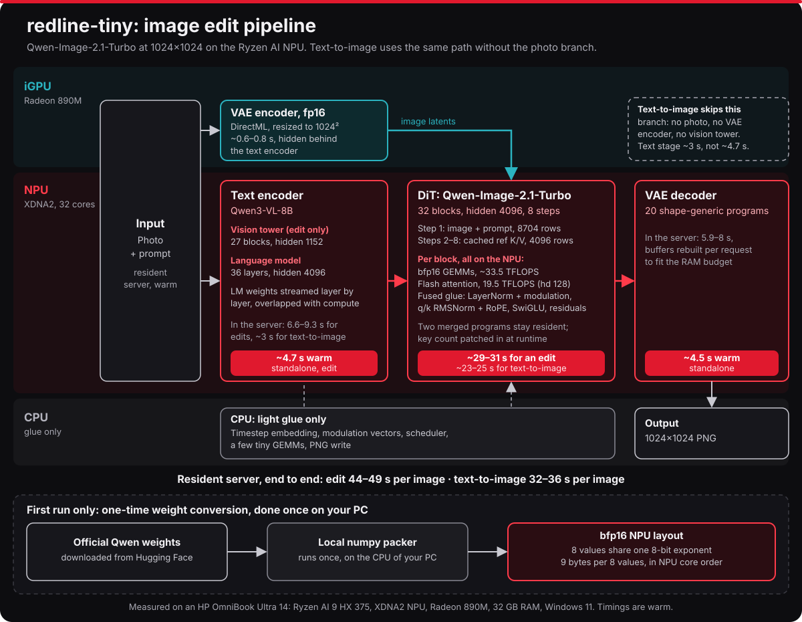

<h1 align="center">redline-tiny</h1>

<b>Qwen-Image-2.1-Turbo photo editing and text-to-image, running on the Ryzen AI NPU of an ordinary Windows laptop.</b> 
1024×1024, 8 steps, about 45 s per edit and 35 s per new image on a Ryzen AI 9 HX 375. No GPU, no cloud.

<a href="#install">Install</a> ·
<a href="#how-it-works">How it works</a> ·
<a href="#benchmarks">Benchmarks</a> ·
<a href="#amd-kernel-hell">AMD kernel hell</a> ·
<a href="https://huggingface.co/spaces/cukrus/redline-tiny">Hugging Face Space</a> ·
<a href="docs/BUILDING.md">Building the NPU programs</a>

Text-to-image on the NPU, seed 0. Prompts in <a href="https://huggingface.co/spaces/cukrus/redline-tiny">the Space</a>.

"tiny" is the laptop NPU build. A bigger sibling is coming :)

## Summary

- **A local web interface.** Drop in a photo and type what should change, or describe a new image. There's a before/after slider, your history, and every result saved as a PNG next to a JSON file with its prompt and seed to make life easier for tuning..
- **The whole model on the NPU.** The Qwen3-VL-8B text encoder, the 32-block DiT and the VAE decoder all run on the XDNA2 NPU. The iGPU encodes the input photo while the NPU reads the prompt. The CPU only does light glue.
- **Reproducible output.** The same prompt, seed and photo give the same bytes every run. Text-to-image uses the diffusers pipeline's noise, so a seed gives the same picture as the reference GPU pipeline.
- **An OpenAI-style API** on `http://127.0.0.1:11290` (`/v1/images/edits`, `/v1/images/generations`) for scripts and other apps that no one will ever use, but it's a nice to have..

## Requirements

| | |
|---|---|
| Chip | AMD Ryzen AI 300-series with an **XDNA2 NPU**. Tested: Ryzen AI 9 HX 375 (Strix Point) and Ryzen AI 7 350 (Krackan Point). |
| RAM | **32 GB**. The NPU's buffers live in pinned system RAM, and the DiT alone peaks at about 12 GB |
| OS | Windows 11 with the AMD NPU driver **32.0.20101.3760 or newer** (XRT 2.21). See [NPU driver](#npu-driver) to avoid anger issues |
| Disk | About **52 GB**: the official model 31 GB, its NPU-packed copy 17 GB, Python and the NPU programs about 4 GB |
| Internet | Initial download only |

### NPU driver

redline-tiny uses the XRT runtime that comes with NPU driver, it doesn't bundle its own copy. So when the driver is too old, the app fails in confusing ways. **The minimum is 32.0.20101.3760 (XRT 2.21)**, the same as AMD's [mlir-aie](https://github.com/Xilinx/mlir-aie/blob/main/docs/buildHostWinNative.md#2-update-and-verify-the-npu-driver), which the app runs on.

**Check your version:** open *Device Manager → Neural processors → NPU Compute Accelerator Device → Driver*, or run `Install.cmd -CheckOnly`, which checks your chip, driver, RAM and disk and downloads nothing.

**Update it:**
1. **[AMD Software: Adrenalin Edition](https://www.amd.com/en/support/download/drivers.html)**: use *Auto-Detect and Install* on that page. NPU driver updates ship with AMD's chipset and graphics package.
2. **Or your laptop maker's support page** (HP, ASUS, Lenovo and so on, searched by model), or *Windows Update → Advanced options → Optional updates, just be sure to check the version*.

> **Careful with the driver zips on the [Ryzen AI Software page](https://ryzenai.docs.amd.com/en/latest/inst.html#install-npu-drivers).** Those are the `32.0.203.x` branch (for example 32.0.203.376), which is *poopier* than 32.0.20101 despite the bigger-looking number. Installing one over a newer driver downgrades it. Mismatches between the driver and XRT versions are a common cause of errors like `Failed to open library ... xrt_core.dll` in NPU apps.

## Install

1. **Download** this repository (green *Code* button → *Download ZIP*) and unzip it somewhere short like `C:\redline-tiny`. Avoid OneDrive folders.
2. **Double-click `Install.cmd`.** If Windows says it protected your PC, click *More info* → *Run anyway*. Setup checks your PC, including the [NPU driver](#npu-driver), then asks for the path of an existing Qwen-Image-2.1-Turbo folder and an existing NPU program folder. Leave a path empty to download that item instead. Before anything is downloaded, setup lists every download with its size and source and asks for confirmation:
   - a private copy of Python and the packages (about 1.5 GB);
   - the official Qwen-Image-2.1-Turbo files from Hugging Face (31 GB), only if no model path was given;
   - the compiled NPU programs (310 MB), only if no NPU program path was given.

   It then packs the weights for the NPU (a few minutes, once), and asks before creating shortcuts and before making a test picture. You can stop it at any time; running it again picks up where it left off.
3. **Double-click `redline-tiny`** on your desktop. Your browser opens the app. Keep the black window open while you use it, and close it to stop and free the memory.

The paths can also be given up front: `Install.cmd -ModelPath "D:\models\Qwen-Image-2.1-Turbo" -NpuPath "D:\redline-tiny-npu"`. `-Yes` answers every prompt with yes and downloads anything not given by path, for unattended installs. Everything lives inside the folder. `Uninstall.cmd` removes the shortcuts and the app's own files; the downloads, packed weights and your pictures stay, and it lists them so you can delete them yourself.

## Using it

- **Edit a photo:** drop or paste a photo, then say what should change ("make the car bright red", "turn it into a watercolour"). Wide photos are squared; choose which part to keep.
- **Create from text:** describe the picture. Longer, concrete prompts work well, up to 512 tokens.
- **Edit prompts are short:** up to 64 tokens, about 40 words. The counter under the prompt tells you when you're over. The limit is the size the NPU programs were compiled for.
- **Seed:** leave it empty for a new result each time, or fix it to reproduce or tweak one. *Faster (6)* reuses two of the eight steps: about 15% quicker, and slightly softer.
- Pictures are saved in `outputs\<date>\`.

## How it works

The weights are stored as **bfp16**, a block floating-point format in which 8 values share one 8-bit exponent (9 bytes per 8 values). They are pre-arranged in the order the NPU cores read them. Every matrix multiply runs on all 32 AIE cores at about 33.5 TFLOPS. Attention is a flash-attention kernel with online softmax at 19.5 TFLOPS, head_dim 128. The per-block "glue" (LayerNorm with modulation, q/k RMSNorm with RoPE, SwiGLU, residuals) runs as fused NPU kernels instead of on the CPU. Each DiT stage is one merged NPU program that stays loaded. The attention key count is patched into its instruction stream per prompt, so any prompt length runs without recompiling.

More detail, including the problems we hit (AIE2P's piecewise-linear `exp2`, a rounding bias in the reference bfp16 packer, pinned-RAM limits), is in [docs/HOW-IT-WORKS.md](docs/HOW-IT-WORKS.md).

## Benchmarks

Ryzen AI 9 HX 375, 32 GB, Windows 11. 1024×1024, 8 steps, warm resident server.

This benchmark does not include FLM/Ryzen default AI stack as neither of them can generate or edit images at a speed that would be acceptable in real world as well as by reddit armchair scientists.

| | redline-tiny | VigenFlow |
|---|---|---|
| Edit, per image | **44 s** | 51–53 s E2E, 75 s wall incl. loading |
| DiT, 8-step edit | **30.5 s** | 42.4–44.0 s |
| Text-to-image, per image | **32–37 s** | 32.9–33.5 s E2E, 42–44 s wall |
| VAE decode | 4.5 s warm, 6–7 s in the server | **2.8 s** |
| One-shot edit incl. all model loading | **66.5–69.8 s** | 74.8–75.6 s |

Big credit to VigenFlow again - the only other alternative worth using

Other reference points. These are not apples to apples: different models, step counts and chips.

| | Model | Setup | Per image |
|---|---|---|---|
| redline-tiny, edit | Qwen-Image-2.1-Turbo (7B DiT + 8B encoder) | HX 375 NPU, 1024², 8 steps | **44 s** |
| Same edit on the CPU | Qwen-Image-2.1-Turbo | HX 375, PyTorch bf16 | 706 s |
| AMD/Stability NPU path (Amuse), [PCWorld test](https://www.pcworld.com/article/2853262/amd-gets-gpu-quality-ai-art-running-on-its-npus.html) | SD3 Medium (2B) | Ryzen AI 9 365 NPU, 20 steps | ~90 s |
| Same, [HotHardware test](https://hothardware.com/news/amd-stable-diffusion-blockfp16-npu) | SD3 Medium (2B) | Ryzen AI Max+ 395 NPU, 1 MP + NPU upscale to 2048² | ~70 s |

The SD3 Medium times are reviewers' measurements. AMD publishes no per-image timings for its NPU image models.

Both were measured on the same laptop, back to back, from the same input and starting noise. [VigenFlow](https://github.com/jia1217/vigenflow) is the clear and simple app running Qwen-Image on the Ryzen AI NPU, and the project that showed tile padding was me overthinking the NPU arch + saved me hours of testing. Its VAE decoder and its text-encoder cold start are faster than this as my focus was on warm serves and text encoder decoupling is in progress [Remote encoder](https://github.com/Cukrus-directive/qwen3-4b-remote-text-encoder). Two uplifts came from VigenFlow's inspiration for NPU programs: the runtime-patched attention key count and the shape-generic VAE decoder programs. I've reimplemented both from scratch to not re-use VigenFlow code. Thanks to its author who is an absolute legend and dropped it's flow right as I was giving up.

## AMD kernel hell

4 weeks, about 150 logged experiments. Noteworthy findings below, including the dead ends. For scale, the same edit on CPU (PyTorch, bf16) takes **706 s**; redline-tiny does it in about **45 s**. One DiT block's kernels went from 3670 ms on the CPU to 97 ms on the NPU (38×). This learning came after joining AMD Developer program and scouring other people's mistakes.

I've attempted to re-use chess compiler after getting licensing from AMD, however, with HRM Loom dropping, I see this as dead end and won't pursue.

✅ kept · ❌ dropped · 🐛 bug found (motivation decrease) · 🔍 finding

**Toolchain and GEMM**

| Tried | What happened | |
|---|---|---|
| AMD's *chess* compiler, from the Ryzen AI 1.8.0 package | Even after acquiring node lock license and testing the instruction set, this turned up as abbandonware | ❌ Just use Peano instead |
| AMD's own Peano 1.8.0 | Can't link with mlir-aie's build scripts, and its loops schedule worse (II 42–43 vs 41) | ❌ |
| An older hand-tuned bfp16 GEMM (mlir-aie v1.3.4 API) | Main loop instead of software-pipelined (~100 loads missing memory-bank annotations); hangs on Strix | ❌ |
| mlir-aie v1.4.4 "config3" bfp16 GEMM | Looked wrong on random data. The kernel was fine: upstream's host helper reads the output tiles in the wrong order | 🐛 fixed host-side → **33.5 TFLOPS** |
| config3 for any K (the 12288-deep down-projection) | 33.6 TFLOPS, correct | ✅ |
| The "55 TOPS" spec, via `xrt-smi validate` | A tiny per-core int8 matmul timed at the maximum clock. The real bfp16 ceiling is 60.9 TFLOPS at 1.86 GHz, and the clock does hold under full load | 🔍 we reach ~90% of AMD's own int8 figure, not gonna say this is false advertising, but AMD really could do better than just napkin math (vega56 launch dejavu) |
| int8, or 4–7-bit weights, for speed | Dense int8 runs at the bfp16 rate. Decoding 4-bit weights in-core (530 ns per tile) costs more than the bandwidth it saves | ❌ no weight format buys speed here |
| What limits a 4096³ GEMM | Data movement alone 3.92 ms, compute alone 3.95 ms, real 4.08 ms: both at once | 🔍 |
| SwiGLU fused into the up-projection's epilogue | Gate and proj interleaved per tile, so one core holds both halves | ✅ |

**Attention**

| Tried | What happened | |
|---|---|---|
| Flash attention from scratch for head_dim 128 (nothing upstream fit) | 1 core → 32 cores → full layer at **19.5 TFLOPS** | ✅ |
| Single-core tuning (forced II, band-outer PV loop) | Slower | ❌ reverted |
| Key-padding mask, first try | Wrong results; computing `exp2` in two 32-lane halves fixed it (17.9 TFLOPS) | 🐛 → ✅ |
| AIE2P's native `exp2`, measured with a known-answer probe | **Piecewise linear**: exactly 2^k·(1+h), up to +6% high. Half the attention error on real data | 🔍 |
| exp2 fix v1: warp the input | Accurate, but 54% slower | ❌ |
| exp2 fix v2: mantissa correction | Wrong on hardware. It mapped exp2(0) to 0.9961, and that compounds over 126 key tiles | 🐛 ❌ |
| exp2 fix v3: the same, with c(1) = 1 exactly | 0.9994–0.9995 vs the reference, at +26% attention time | ✅ |
| Attention V6: lazy rescale, PV loop shaped like the GEMM microkernel | Pipelines at II 41, no register spills | ✅ |
| Attention V7: subtraction-free softmax | Didn't fit the 16 KB program memory without losing V6's inlined exp loop | ❌ |
| Block-sparse attention (lossy) | Quality loss on real data | ❌ |
| Valid-key count patched into the instruction stream at runtime (idea from VigenFlow) | One program for every prompt length, byte-identical output | ✅ |

**Glue and numerics**

| Tried | What happened | |
|---|---|---|
| LayerNorm, RMSNorm + RoPE, SwiGLU and residuals on the CPU | ~36 s per edit | ❌ → fused NPU kernels, under 1 s |
| mlir-aie's `silu_vec` | Uses AIE2P's native `vtanh`, which returns its input for \|x\| ≤ 0.5: sigmoid ~2.6% off | 🐛 own exp2-based sigmoid |
| mlir-aie's host bfp16 packer | Truncates where the hardware rounds half to even: a −0.5 LSB bias in every packed weight | 🐛 our packer is byte-identical to the NPU |
| Transformer timestep | The pipeline casts σ·1000 to bf16 *before* dividing (0.978 → 980 → 0.98047); we had bf16(σ) | 🐛 fixed |
| Cached steps 2–8 chained | Diverged (correlation 0.45 by step 7): a scratch buffer reused as block 0's zero residual | 🐛 fixed |
| Async NPU runs from Python | A temporary freed while its run was still pending → the NPU read freed memory, all-NaN output | 🐛 keep arguments alive until the wait |

**System**

| Tried | What happened | |
|---|---|---|
| ~10 separate programs per DiT block | 2.2 ms per full-array context switch ≈ 5–6 s per edit | ❌ → one merged ELF per DiT stage, async submits (−13.5%) |
| Strix's 16 hardware contexts | The text encoder alone uses 22 programs, so contexts get evicted every encode | 🔍 release contexts between stages |
| Keep every model resident on the NPU | Out of RAM on the second edit: NPU buffers are pinned (DiT 12.1 GB + text encoder 9.4 GB) | ❌ → only the DiT stays resident; the LM is streamed per layer, DM me if you have 64gb ram and can test |
| VAE decoder as 44 shape-specific programs | 1.1–1.9 s lost to context switching | ❌ → 20 shape-generic programs with runtime trip counts |
| The whole VAE decoder in one merged ELF | 1.35 s faster alone, but pins 2.9 GB and evicts the text encoder's weights: slower overall | ❌ |
| VAE encoder on the iGPU (DirectML, fp16) | 0.6 s, more accurate than our NPU encoder, overlapped with the text encoder | ✅ |
| VAE decoder on the iGPU in fp16 | Hangs the 890M (Windows GPU timeout) | ❌ decode stays on the NPU, will re-test in future |
| Fewer steps / reuse the previous step | 6 of 8 ≈ free (−7.5 s); 4 visibly breaks | ✅ as the *Faster (6)* option |
| Resident server instead of one-shot runs | 44–49 s per edit vs 56–70 s with loading | ✅ |
| torch imported in the NPU process | +5 s per image (slower numpy host glue) | ❌ → `tokenizers` only; torch stays in helper processes |

## Limitations

- 1024×1024 only, one reference image per edit.
- 32 GB RAM minimum. Close big apps first: the NPU's working set is pinned and can't be paged out. Suggest using [w11 efficiency booster](https://github.com/Cukrus-directive/W11EfficiencyBooster)
- Tested on hx375 and Ryzen AI 7 350, both work fine. Reports from other Ryzen AI chips are very welcome. Open an issue and attach `logs\install.log` / `logs\server.log`.
- Windows only. The NPU programs are portable, but the runtime glue is Windows-specific (driver, DirectML).

## Licences

- **redline-tiny code:** Apache-2.0 ([LICENSE](LICENSE)). The GEMM kernels in `kernels/atb3` and `kernels/vlm` are derived from AMD's [mlir-aie](https://github.com/Xilinx/mlir-aie) examples (Apache-2.0 WITH LLVM-exception) and say so in their headers. See [NOTICE](NOTICE).
- **The model:** [Qwen-Image-2.1-Turbo](https://huggingface.co/Qwen/Qwen-Image-2.1-Turbo) by the Qwen team is under the **Qwen Research License: non-commercial use only** ([copy](docs/QWEN-RESEARCH-LICENSE.txt)). The installer downloads the official files from Hugging Face. Please don't waste your time with poopy quants.
